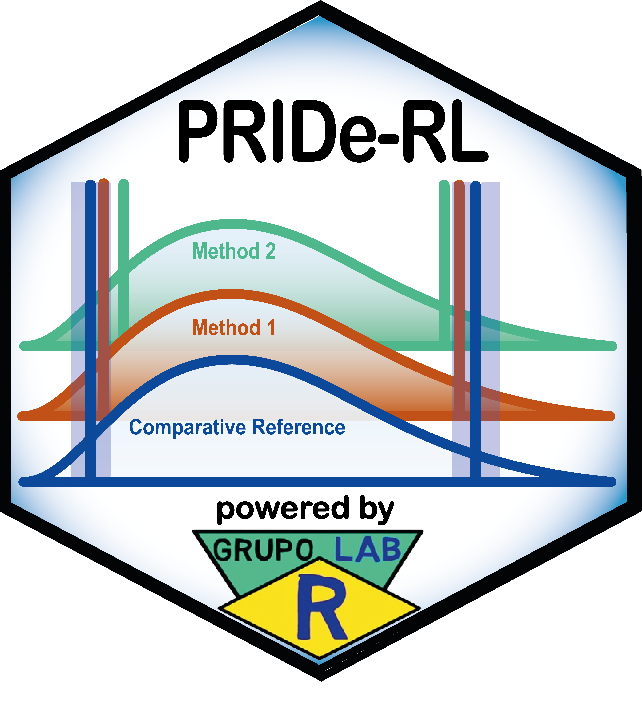

# PRIDe-RL — Shiny Application and Excel Tool

[](https://www.gnu.org/licenses/gpl-3.0.en.html)
[](https://github.com/labrgrupo/PRIDe-RL_shiny/commits/main)
[](https://github.com/labrgrupo/PRIDe-RL_shiny/releases/latest)
[](https://doi.org/10.5281/zenodo.23747544)



The **Performance Ranking by Index of Deviation of Reference Limits (PRIDe-RL)** framework supports the comparative evaluation and ranking of methods that estimate lower and upper reference limits.

This repository provides the **local desktop Shiny application**. The downloadable release package also includes an **Excel tool**, supplied as a separate workbook alongside the Shiny application folder.

The Shiny application compares each estimated reference limit with a user-defined **comparative reference limit**, calculates permissible-difference-based **equivalence intervals**, derives the **reference limit deviation index** (`D_RL`), displays a combined heatmap, and summarizes method performance through direct and multidimensional rankings.

It runs on the user's computer through R and RStudio and saves analysis configurations, results tables, a 600 dpi heatmap, and a self-contained HTML report locally. The Excel tool can be opened directly in Microsoft Excel without R or RStudio.

> A complementary **cloud-ready Shiny implementation** for Posit Connect, Posit Cloud, and institutional Shiny servers is available at [**PRIDE-RL_shiny_connect**](https://github.com/labrgrupo/PRIDE-RL_shiny_connect).

---

## Main capabilities of the Shiny application

- comparison of two or more reference-limit estimation methods;
- support for multiple assessment groups and analytes;
- comparative lower and upper reference limits for each analyte;
- 80% or 90% nominal central coverage of the equivalence interval;
- calculation of the `D_RL` index for every estimated reference limit;
- direct ranking based on inclusion within equivalence intervals;
- multidimensional evaluation through Conformity, Proximity, Tail behaviour, and Severity;
- calculation of the composite PRIDe-RL score;
- combined heatmap exported at 600 dpi;
- self-contained HTML analytical report;
- export of analytical tables to Excel;
- direct block paste from Excel, Google Sheets, and CSV files opened in spreadsheet software;
- responsive interface for desktop computers, notebooks, tablets, and mobile devices;
- local persistence of configurations and generated outputs.

---

## PRIDe-RL analytical framework

PRIDe-RL does not estimate reference intervals directly from raw patient results. It evaluates how closely reference limits generated by different estimation methods agree with a specified comparative reference.

For each lower reference limit (`LRL`) and upper reference limit (`URL`), an equivalence interval is calculated based on the permissible analytical uncertainty associated with that comparative reference limit. Each estimated limit is then expressed on a common normalized scale through the reference limit deviation index:

```text
D_RL = (estimated RL - comparative RL) / permissible difference
```

The main interpretation is:

- `D_RL = 0` indicates agreement with the comparative reference limit;
- `|D_RL| <= 1` indicates inclusion within the equivalence interval;
- `|D_RL| > 1` indicates that the estimate lies outside the equivalence interval;
- the sign indicates whether the estimated limit is below or above the comparative limit.

The distribution of the `D_RL` indices is evaluated through four complementary performance dimensions:

- **d1 — Conformity:** proportion of evaluated limits contained within their equivalence intervals;
- **d2 — Proximity:** overall closeness of the estimated limits to their comparative limits;
- **d3 — Tail behaviour:** behaviour of the upper tail of the absolute deviation distribution;
- **d4 — Severity:** frequency of deviations greater than twice the permissible difference.

The **PRIDe-RL score** integrates these four dimensions into a single measure ranging from 0 to 1. Higher values indicate better overall agreement with the comparative reference limits. The complete equations, variable definitions, methodological notes, and references are included in the Shiny application.

---

## Download the local package

Open the [**latest GitHub release**](https://github.com/labrgrupo/PRIDe-RL_shiny/releases/latest) and, under **Assets**, download **`PRIDE-RL-Shiny-v1.17.31.zip`**. The ZIP includes both the **Shiny application** and the **Excel tool**.

<div align="center">

### Download the latest local release

<a href="https://github.com/labrgrupo/PRIDe-RL_shiny/releases/latest/download/PRIDE-RL-Shiny-v1.17.31.zip">
  
</a>

</div>

Do not download GitHub's automatically generated **Source code (zip)** or **Source code (tar.gz)** files. Those files are repository snapshots, not the prepared distribution package.

---

## Package contents and local outputs

Extract the complete ZIP file to a normal folder. The main components and output locations are organized as follows:

```text
├── PRIDE-RL-Shiny-v1.17.31/
│   ├── app.R
│   ├── Install_packages.Rmd
│   ├── Read_Me/
│   └── 1_Outputs/
│       ├── saved_params.rds
│       ├── PRIDe-RL_Report.html
│       ├── PRIDe-RL_Tables.xlsx
│       └── Figures/
│           └── PRIDe-RL_heatmap_600dpi.png
└── PRIDE-RL tool.xlsx
```

- **`app.R`** — Shiny interface, analytical calculations, rankings, heatmap, methodological documentation, references, and HTML-report generator.
- **`Install_packages.Rmd`** — checks and installs the packages required to run the Shiny application.
- **`Read_Me/`** — beginner-oriented installation and user guide in Markdown, R Markdown, and PDF formats.
- **`1_Outputs/`** — destination for saved configurations, HTML reports, Excel results tables, and exported figures. The files shown inside this folder are created or updated during application use.
- **`PRIDE-RL tool.xlsx`** — separate Excel implementation of the framework, located alongside the Shiny application folder. It differs from `PRIDe-RL_Tables.xlsx`, which contains results exported by the Shiny application.

The repository also includes **`logo_PRIDe-RL.png`**, displayed on this page. The application logo and high-resolution scoring-framework figure used inside the Shiny interface and HTML report are embedded directly in `app.R` as Base64 data.

---

## Quick start

### Excel tool

Open **`PRIDE-RL tool.xlsx`** in **Microsoft Excel**. R and RStudio are not required.

### Shiny application

1. Install **R 4.2 or later** from [CRAN](https://cran.r-project.org/).
2. Install **RStudio Desktop** from [Posit](https://posit.co/downloads/).
3. Open RStudio and, from the extracted **`PRIDE-RL-Shiny-v1.17.31/`** subfolder, open `Install_packages.Rmd`.
4. Click inside the installation code block and select **Run Current Chunk**, or click the small green triangle at the upper-right corner of the block.
5. Wait until `shiny`, `kableExtra`, and `xml2` are reported as `TRUE`.
6. Close `Install_packages.Rmd` and open `app.R` from the same subfolder.
7. Click **Run App** at the upper-right corner of the RStudio editor.

Do not run the application from inside the compressed ZIP file. Keep RStudio open while using the Shiny application.

The tutorial in **`Read_Me/`** covers installation, application startup, data entry, spreadsheet paste, group and method configuration, analysis generation, interpretation of results, output files, and troubleshooting.

---

## Live web demonstration

A public demonstration of the cloud-ready Shiny implementation is available on Posit Connect Cloud:

<div align="center">

<a href="https://labrgroup-pride-rl.share.connect.posit.cloud/" target="_blank">
  
</a>

</div>

End users can access the demonstration directly from a browser without installing R or RStudio. The public deployment is intended for demonstration and training. Do not enter confidential, identifiable, or institutionally restricted information in the public version.

---

## Local Shiny application vs. cloud-ready implementation

The two Shiny implementations use the same analytical framework and generate equivalent analytical results. They differ primarily in deployment and output management. The comparison below refers to the Shiny implementations; the Excel tool is supplied separately in the local release package.

| Feature | Local Shiny application | PRIDE-RL_shiny_connect |
|---|:---:|:---:|
| Primary use | Local desktop analysis | Web or institutional deployment |
| Runs on the user's computer | Yes | Optional |
| Requires R and RStudio for the end user | Yes | No, when already deployed |
| Designed for Posit Connect or Posit Cloud | No | Yes |
| Browser access through a public web address | No | Yes |
| Saves the complete configuration locally | Yes | No persistent server copy |
| Automatically saves the 600 dpi heatmap | Yes | No persistent server copy |
| Automatically saves the HTML report | Yes | No persistent server copy |
| Allows manual HTML-report download | Yes | Yes |
| Uses session-specific temporary files | No | Yes |
| Suitable for multi-user access | No | Yes |

### Local desktop version

The local Shiny version supports individual analytical work, reproducible desktop workflows, larger analyses without public-cloud session constraints, and automatic retention of outputs. It requires R, RStudio, and the packages listed in `Install_packages.Rmd`.

### Cloud-ready version

The [**PRIDE-RL_shiny_connect**](https://github.com/labrgrupo/PRIDE-RL_shiny_connect) version is intended for deployment on Posit Connect, Posit Cloud, or an institutional Shiny server. It operates in session-based mode, does not permanently store user outputs in the server directory, and allows the generated HTML report to be downloaded manually.

---

## Important use statement

PRIDe-RL is intended for research, method comparison, and laboratory quality-assurance activities. Results must be interpreted by qualified professionals together with the analytical, biological, and clinical context.

The tools are not intended to make individual diagnostic decisions or replace professional judgment.

---

## Contact

**Suggestions and bug reports:**  
[https://github.com/labrgrupo/PRIDe-RL_shiny/issues](https://github.com/labrgrupo/PRIDe-RL_shiny/issues)

**Email:**  
[alancdias@hotmail.com](mailto:alancdias@hotmail.com) · [labrgrupo@gmail.com](mailto:labrgrupo@gmail.com)

**Lab R Group website:**  
[https://grupolabr.com/](https://grupolabr.com/)

---

## License

Distributed under the **GNU General Public License v3.0 (GPL-3.0)**.
